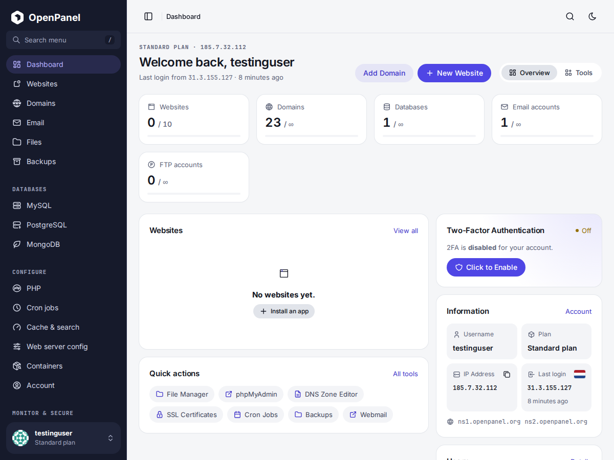

# modern-openpanel-theme

Modern is a redesigned theme for the OpenPanel 2.x user panel: a dark sidebar, the `op-` component kit (cards, tool tiles, chips, segmented switches), a dashboard with **Overview** and **Tools** views, and a guided installer for apps.



## Install

```bash
git clone https://github.com/caesarmind/modern-openpanel-theme /etc/openpanel/openpanel/templates/modern
opencli config update template modern
```

The command restarts the panel so the theme loads right away. You can also pick **Modern** in **OpenAdmin > Settings > OpenPanel > Theme**.

## Panel versions

The theme runs on OpenPanel 2.0.28 and later. A few things only turn on when the panel is new enough: on 2.0.29+ the file editor saves without reloading, and bulk delete, copy, move and trash actions go out as one request. `base.html` sets `window.opPanelVersion` and `opPanelAtLeast()` for that check.

## What's inside

The theme only holds the files it changes, every other page comes from the panel's built-in templates, so those keep following panel updates.

- `base.html`, `partials/`, and the page folders (`dashboard/`, `domains/`, `emails/`, `files/`, `manager/`, ...): the redesigned pages.
- `partials/_op_icons.html`: the icon set the pages use.
- `static/css/op.css`, `static/js/op-kit.js`: the component kit.
- `static/js/install-wizard.js`, `static/js/conf-editor.js`: the app installer and the config editor.
- `static/js/editor-draft.js`: the panel's unsaved-edits script, shipped with the theme so drafts also work on panels older than 2.0.29.
- `static/images/apps/`: app logos for the installer.
- `static/vendor/fonts/inter/`: Inter (SIL Open Font License).
